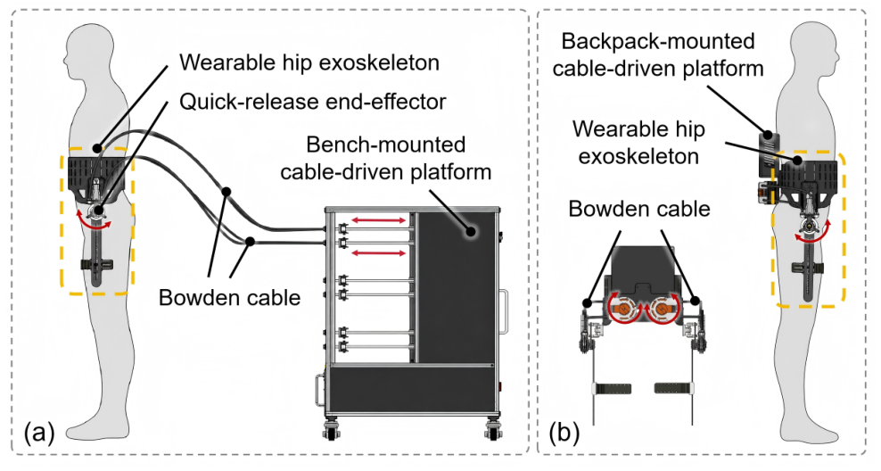
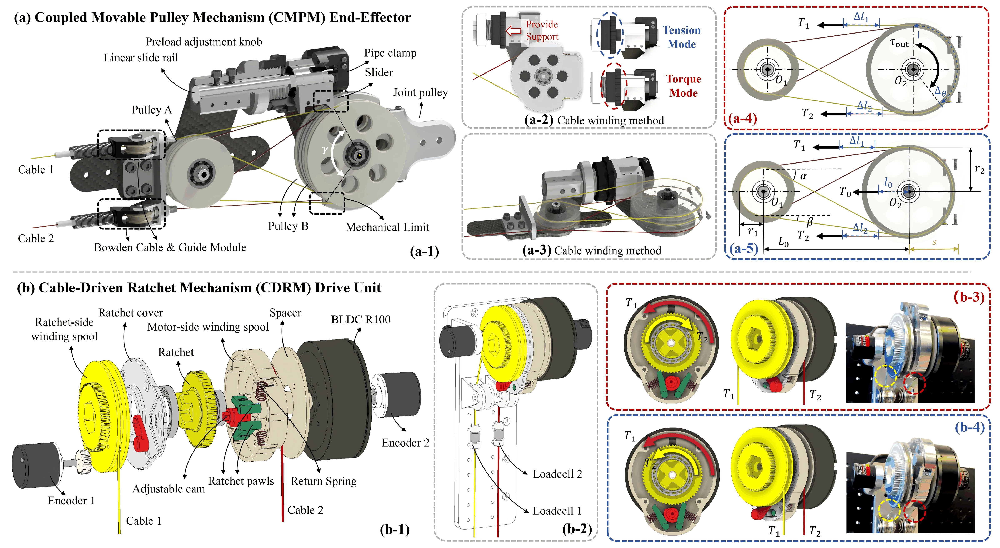
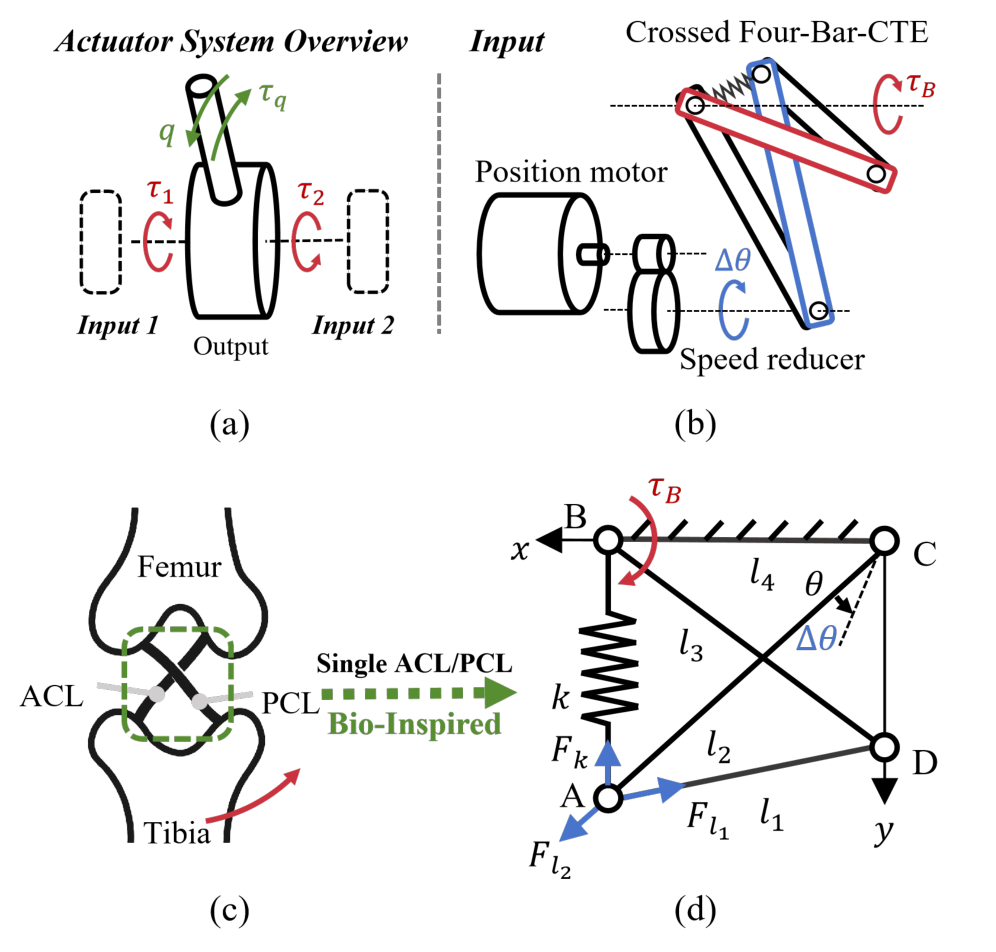
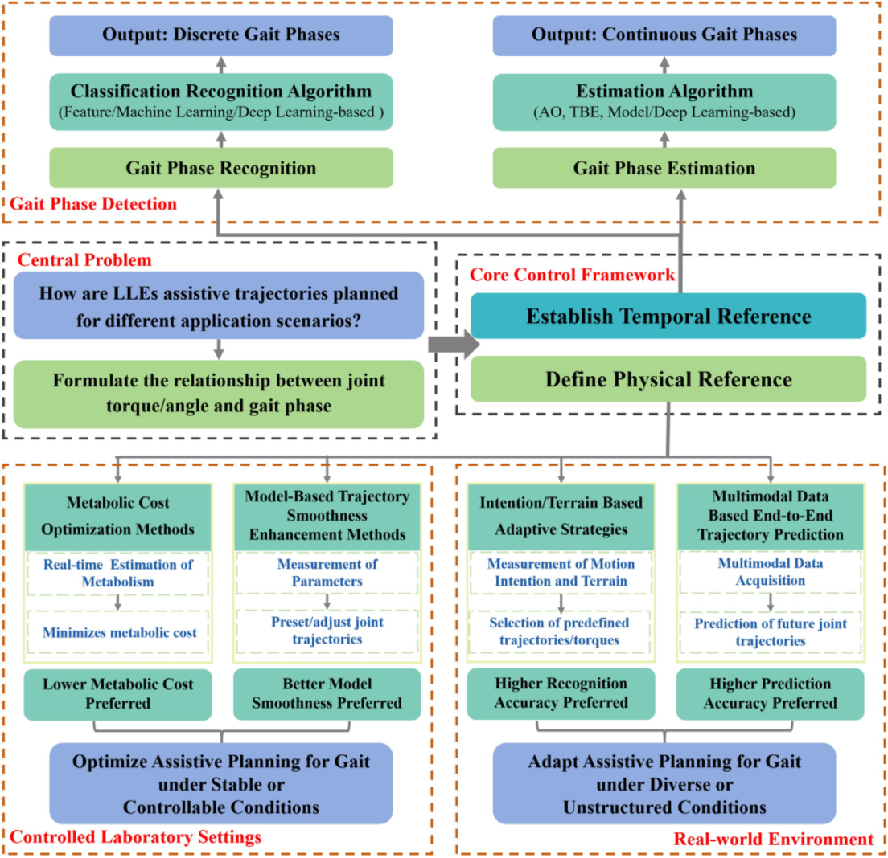
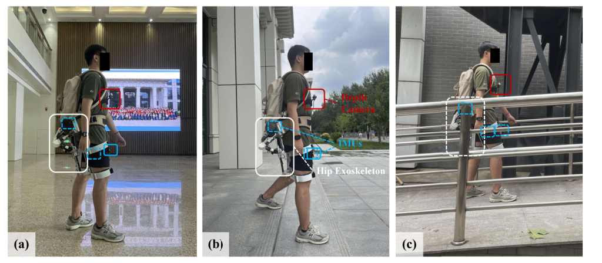
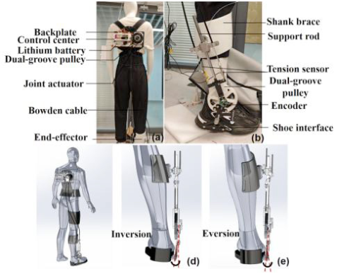
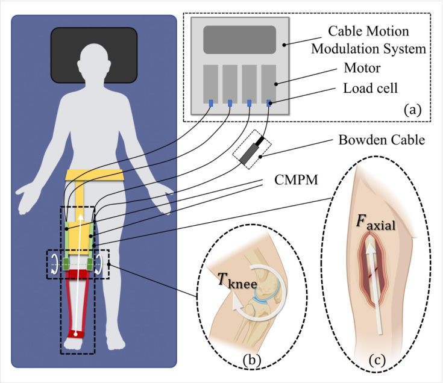
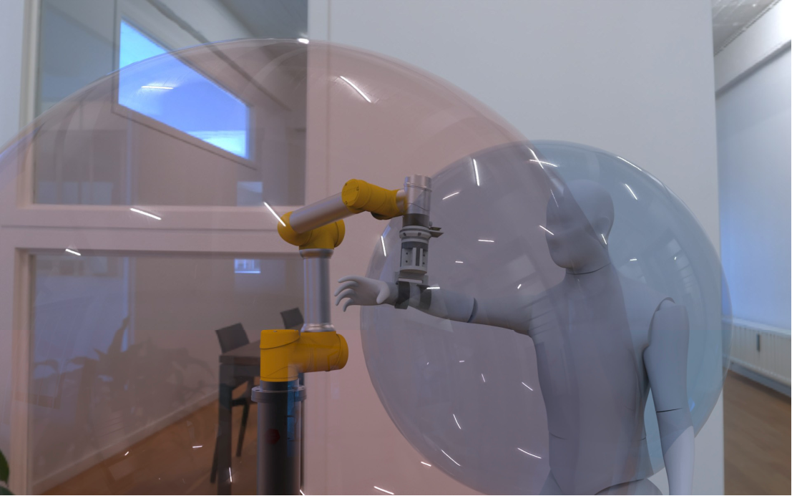

**8 international journal and conference papers** and **2 preprints**, grouped by year from newest to oldest.

## 2026

<figure class="paper-figure"><figcaption>Layered position–stiffness control</figcaption></figure>

### [1] Simulation Modeling and Control of an Elastic Shaping Antagonistic Variable Stiffness Actuator

**Yuanlong Ji**, Ruizhe Jiang, Dongrun Jin, Xiangyu Xie, Junheng Lin, Xingbang Yang  
*arXiv:2611.07504*  
**2026 · Co-first author, listed first · Preprint · Posted 5 November 2026**

Extending the ACIRS mechanism study, this work links elastic shaping, independent ADAMS–Simulink model comparisons and layered state-estimation, decoupling and compensation control. In the tested simulations, the maximum joint-angle RMSE between models was 4.66 × 10⁻³ rad; EKF reduced velocity-estimation RMSE by over 97% relative to direct differentiation.

[Abstract](https://arxiv.org/abs/2611.07504) · [PDF](https://arxiv.org/pdf/2611.07504)

<figure class="paper-figure"><figcaption>Bench and backpack configurations</figcaption></figure>

### [2] A Reconfigurable Bidirectional Cable-Driven Hip Exoskeleton with Swappable Bench/Backpack Dual-configuration Actuation

**Yuanlong Ji**, Shuhan Xiang, Qihan Ye, Xingbang Yang  
*arXiv:2609.25639*  
**2026 · First author · Preprint · Posted 22 September 2026**

A shared wearable hip interface supports both bench-mounted laboratory experiments and backpack-mounted outdoor walking. Across 30 trials with three healthy participants, configuration switching took 30.1 ± 16.3 seconds.

[Abstract](https://arxiv.org/abs/2609.25639) · [PDF](https://arxiv.org/pdf/2609.25639) · <a href="/assets/videos/reconfigurable-exoskeleton-supplementary.mp4" target="_blank" rel="noopener">Video</a>

<figure class="paper-figure"><figcaption>Dual-mode actuator</figcaption></figure>

### [3] Design and Control of a Cable-Driven Switchable Actuator with Torque/Tension Dual Modes for Exoskeletons

**Yuanlong Ji**, Xu Liu, Xinyuan Cai, Qihan Ye, Xiangyu Xie, Ruizhe Jiang, Shuhan Xiang, Wenjing Liu, Qijun Wang, Yang Chen, Xingbang Yang  
*IEEE Robotics and Automation Letters*  
**Journal article · RA-L · 2026 · First author · Accepted 16 September 2026**

Switchable torque and tension output connects different assistance requirements within one cable-driven actuator.

<a href="/assets/videos/ral-supplementary.mp4" target="_blank" rel="noopener">Video</a>

<figure class="paper-figure"><figcaption>Variable-stiffness mechanism</figcaption></figure>

### [4] Optimization Design and Simulation Validation of a Variable Stiffness Actuator Based on a Crossed Four-Bar Mechanism

**Yuanlong Ji**, Ruizhe Jiang, Xiangyu Xie, Junheng Lin, Dongrun Jin, Xingbang Yang  
*11th Asia-Pacific Conference on Intelligent Robot Systems*  
**Conference paper · ACIRS · 2026 · First author · Accepted; oral presentation in August 2026**

Mechanism optimization and simulation validation of a variable-stiffness actuator.

<figure class="paper-figure"><figcaption>Trajectory-planning framework</figcaption></figure>

### [5] Assistive Trajectory Planning for Lower Limb Exoskeletons: Strategies From Laboratory-Optimized Gait to Environmentally-Adaptive Locomotion Through Multimodal Parameter Awareness

Qihan Ye, Xingbang Yang, Ruoqi Zhao, **Yuanlong Ji**, Xinyuan Cai, Quan Zheng, Yubo Fan  
*IEEE Reviews in Biomedical Engineering, 19: 41–64 (online 2025)*  
**Journal article · RBME · 2026 · Fourth author · Published**

A review connecting assistive trajectory planning, multimodal awareness and environment-adaptive locomotion.

[Paper](https://doi.org/10.1109/RBME.2025.3646165)

## 2025

<figure class="paper-figure"><figcaption>Wearable field experiments</figcaption></figure>

### [6] Human Locomotion Implicit Modeling-Based Real-Time Gait Phase Estimation

**Yuanlong Ji**, Xingbang Yang, Ruoqi Zhao, Qihan Ye, Quan Zheng, Yubo Fan  
*IEEE Transactions on Neural Systems and Rehabilitation Engineering, 33: 4124–4136*  
**Journal article · TNSRE · 2025 · Co-first author, listed first · Published**

Continuous gait-phase estimation for wearable assistance; reported steady-state phase RMSE: 2.729%.

[Paper](https://doi.org/10.1109/TNSRE.2025.3621076) · [Dataset](https://huggingface.co/datasets/YuanlongJi/GPE-MM) · [Media coverage](https://mp.weixin.qq.com/s/UTPk6sCkNiAYqhE9mv0wvg)

<figure class="paper-figure"><figcaption>Ankle exoskeleton system</figcaption></figure>

### [7] A Compliant Transition Control Strategy for Plantarflexion-Dorsiflexion Switch in a Bidirectional Cable-Driven Ankle Exoskeleton

Wenjing Liu, **Yuanlong Ji**, Mengnan Zhou, Yu Song, Quan Zheng, Yubo Fan, Xingbang Yang  
*IFAC-PapersOnLine, 59(35): 362–367*  
**Conference paper · IFAC HMS · 2025 · Second author; conference paper · Published**

Compliant switching between plantarflexion and dorsiflexion assistance in a cable-driven ankle exoskeleton.

[Paper](https://doi.org/10.1016/j.ifacol.2025.12.503)

## 2024

<figure class="paper-figure"><figcaption>Orthopedic rehabilitation system</figcaption></figure>

### [8] Conceptual Design and Preliminary Experiment of an Orthopedic Rehabilitation Exoskeleton Based on the Coupled Movable Pulley Mechanism (CMPM)

**Yuanlong Ji**, Xuzhou Lang, Bo Wu, Quan Zheng, Yubo Fan, Xingbang Yang  
*World Rehabilitation Robot Convention, pp. 1–6*  
**Conference paper · WRRC · 2024 · First author; Best Paper Award · Published**

A coupled movable pulley mechanism supports versatile orthopedic rehabilitation; WRRC Best Paper Award.

[Paper](https://doi.org/10.1109/WRRC62201.2024.10696897)

## 2023

<figure class="paper-figure"><figcaption>Safe-interaction apparatus</figcaption></figure>

### [9] A Safe Admittance Boundary Algorithm for Rehabilitation Robot Based on Space Classification Model

Yong Tao, **Yuanlong Ji**, Dongming Han, He Gao, Tianmiao Wang  
*Applied Sciences, 13(9): 5816*  
**Journal article · Applied Sciences · 2023 · Second author; supervisor first, first student author · Published**

A space-classification model defines safe admittance boundaries for physical human–robot interaction.

[Paper](https://doi.org/10.3390/app13095816)

## 2020

### [10] Design and Development of Management and Control System for Intelligent Die Forging Production Line

**Yuanlong Ji**, Shuwen Sun, Zhifeng Liu, Chenfei Liu  
*World Conference on Mechanical Engineering and Intelligent Manufacturing, pp. 230–233*  
**Conference paper · WCMEIM · 2020 · First author · Published**

An early foundation in mechatronic integration and intelligent manufacturing control.

[Paper](https://doi.org/10.1109/WCMEIM52463.2020.00054)

## Media coverage

- **28 October 2026:** Gave an invited talk, “From the Laboratory to Everyday Life: Reconfigurable Design and Human–Robot Collaborative Sensing for Lower-Limb Exoskeletons,” at the Young BME Science and Technology Forum Series, organized by the Chinese Society of Biomedical Engineering and hosted by its Flexible Bioelectronics and Wearable Medicine Branch. [Media coverage](https://mp.weixin.qq.com/s/M6TYGhtGW_o3FDPqdy58Mw)

- [WeChat coverage by the Rehabilitation Engineering Branch of the Chinese Society of Biomedical Engineering](https://mp.weixin.qq.com/s/UTPk6sCkNiAYqhE9mv0wvg) — Coverage of our TNSRE research on gait-phase estimation.
